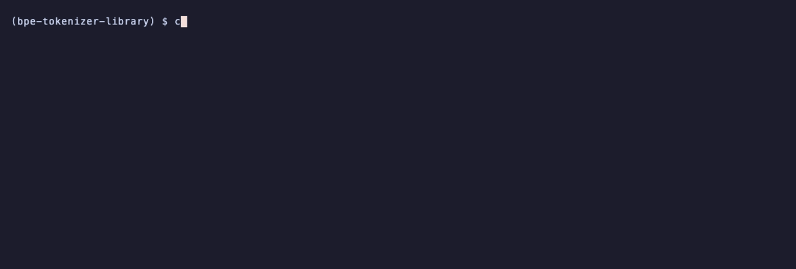
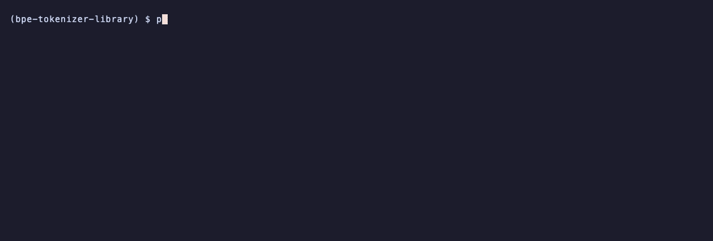

<h1 align="center">BPE Tokenizer Library</h1>

<p align="center">
  <em>A byte-level byte-pair-encoding tokenizer implementing the GPT-2 algorithm, with a Rust core that runs by default and a reference Python implementation that it matches token for token.</em>
</p>

<p align="center">
  <a href="https://github.com/adeoluo/bpe-tokenizer-library/actions/workflows/ci.yml"></a>
  <a href="https://github.com/adeoluo/bpe-tokenizer-library/releases"></a>
  
  
  <a href="LICENSE"></a>
</p>

---

## Motivation

Every language model starts with a tokenizer, and the one used by GPT-2 and its successors is
**byte-level byte-pair encoding**. It has three parts worth understanding: a reversible map from
bytes to printable glyphs that makes the tokenizer lossless for any input, a regular expression
that splits text into word-like chunks, and a learned list of merges applied by rank. This
library implements all three, matching the GPT-2 algorithm. The Python implementation is the
readable reference and needs nothing beyond the standard library.

Because it is byte-level, it round-trips **any** string exactly, including emoji, accented text,
and non-Latin scripts, which tokenizers that split on characters cannot guarantee.

Encoding and training run on a Rust core, exposed through PyO3 and compiled into the package
on install, so it is what every user gets. It encodes 13 to 19 times faster than the Python
implementation and is tested to produce byte-for-byte identical output; the Python version is kept
as the readable reference that the Rust core is checked against.

## Architecture

<p align="center">
  
</p>

<sub>Legend: amber = entry points and external systems, indigo = core logic, green = data and state, blue = validation and control, grey = observability and outputs.</sub>

Training counts adjacent symbol pairs across a pre-tokenized, byte-level corpus and repeatedly
merges the most frequent pair, producing an ordered merge list that is the model. Encoding applies
those merges by rank within each chunk. `BPETokenizer` is the single Python API: by default
(`backend="rust"`) it delegates to the `bpe_tokenizer_rs` extension (Rust core via PyO3) that the
install compiles into the package, and only if the extension is missing does it fall back to the
Python implementation. Parity tests hold the
two paths to identical output. The HTTP service validates text length and id ranges before calling
the same API and exposes Prometheus metrics, and the evaluation reports compression, round-trip
losslessness, and throughput. See the [ADRs](docs/adr/) for the key decisions.

### What it implements

- **Reversible byte-level mapping**: GPT-2's fixed map from the 256 byte values to printable code
  points, so any UTF-8 text becomes carry-able glyphs and back with no loss.
- **GPT-2 pre-tokenization**: the standard regular expression that keeps leading spaces attached,
  separates letters, digits, and punctuation (underscores included), and never merges across
  chunk boundaries.
- **BPE training**: iterative most-frequent-pair merging with a deterministic tie-break.
- **Rank-based encoding**: the same lowest-rank-first merge application GPT-2 uses, plus JSON
  save and load.
- **Rust core** (`rust/`): the same pre-tokenizer, byte map, merge loop, and trainer in Rust. The
  pre-tokenizer uses character-class tables generated from Python's own `re` module for each
  supported Unicode version, and the merge loop switches to a heap for long chunks.

## Results

> Reproduce with `python -m bpe_tokenizer_library train`. Trained on the built-in corpus; metrics
> are on a disjoint held-out passage.

| Vocabulary size | Compression (bytes/token) | Lossless |
|---|---:|:--:|
| 256 (no merges) | 1.00 | yes |
| 400 | 2.42 | yes |
| 600 (requested) | 3.74 | yes |

The small bundled corpus saturates at 237 merges (vocabulary 493), so requesting a larger
vocabulary does not add tokens; a larger corpus continues to improve compression. Compression
improves from one token per byte to **3.74 bytes per token** as merges are learned, and every
configuration round-trips the full battery of adversarial strings (emoji, Japanese, accents,
control whitespace, empty) **exactly**.

### Encode throughput: Python, Rust, tiktoken

> Reproduce with `uv sync --group rust`, `uv run maturin develop --uv --release -m rust/Cargo.toml`,
> then `uv run python benchmarks/compare.py`. Apple M1, macOS, Python 3.13, single thread, best of
> five runs on about 1 MB of text. The machine was shared and under load during the run, so the
> absolute figures are conservative; the ratios are the stable part.

| Workload | Python backend | Rust backend | tiktoken (gpt2) | Rust / Python |
|---|---:|---:|---:|---:|
| English text, 1 MB | 0.47 MB/s | 8.85 MB/s | 8.88 MB/s | 19x |
| Random Unicode, 1 MB | 1.22 MB/s | 15.45 MB/s | 5.14 MB/s | 13x |

The Python and Rust columns use the same merges (vocabulary 493) and return identical token ids;
the benchmark asserts this before timing. tiktoken runs its own GPT-2 vocabulary of 50,257 tokens,
so its column is a throughput reference only: the vocabularies, and therefore the token ids and
the amount of merge work per byte, differ, and the figures do not show that one tokenizer is
faster than the other on equal terms. The equal-vocabulary comparison on real text is below.

### Trained on real web text at GPT-2's vocabulary size

> Reproduce with two C4 English shards
> (`https://huggingface.co/datasets/allenai/c4/resolve/main/en/c4-train.0000N-of-01024.json.gz`),
> then `uv run --no-sync --with tiktoken python benchmarks/c4_scale.py --c4 <shard 0> --heldout <shard 1>`.
> Apple M1, 8 cores. Raw numbers: [benchmarks/results/c4_scale.json](benchmarks/results/c4_scale.json).

The trainer finds the next merge with a max-heap ordered exactly like Python's rule (highest count,
then the lexicographically smallest pair), instead of scanning every pair count for each merge. It
learns the same merges as before, which the parity suite checks against the Python trainer:

| C4 text | Vocabulary | Previous trainer | Heap trainer | Speedup | Same merges |
|---:|---:|---:|---:|---:|:---:|
| 1 MB | 8,192 | 0.6 s | 0.2 s | 2.8x | yes |
| 4 MB | 8,192 | 1.3 s | 0.5 s | 2.5x | yes |
| 16 MB | 8,192 | 2.8 s | 1.4 s | 2.0x | yes |
| 100 MB | 50,257 | 47.8 s | 6.7 s | **7.1x** | yes |

A 50,257-token vocabulary, the size of GPT-2's, trained on 100 MB of C4
in 6.7 seconds. Against tiktoken's GPT-2 encoding on 20 MB of
held-out C4 (9,509 documents from a different shard), with the same vocabulary size:

| Tokenizer | Bytes per token (higher is better) | Encode, 1 thread | Encode, batch (8 threads) |
|---|---:|---:|---:|
| **bpe-tokenizer-library, trained on C4** | **4.61** | **19.4 MB/s** | **68.5 MB/s** |
| tiktoken gpt2 | 4.54 | 18.8 MB/s | 52.4 MB/s |

How to read this: compression is 1.5% better, but this tokenizer was trained on C4 itself while GPT-2's
vocabulary was trained on WebText, so part of that edge is in-domain training rather than a better
algorithm. Single-threaded encoding is on par with tiktoken (within 3%). Batch encoding is 1.3x
faster because `encode_batch` now spreads texts across all cores with the GIL released. Every
held-out document round-trips exactly.

### Parity guarantee

The Rust backend is required to match the Python implementation byte for byte: the same
pre-tokenization chunks, the same token ids, the same decoded text (including how invalid UTF-8
is replaced), the same errors for unknown ids, and the same trained merges. The parity suite
(`tests/test_rust_parity.py`) checks this on:

| Check | Inputs | Mismatches |
|---|---:|---:|
| Pre-tokenization | 12,223 strings, plus every Unicode scalar value in four arrangements | 0 |
| Encode ids and round-trip decode | 12,223 strings x 4 merge sets (0 to 944 merges) | 0 |
| Decode of random id sequences | 3,000 sequences, mostly invalid UTF-8 | 0 |
| Training | 3 corpora x 3 vocabulary sizes | 0 |

The strings are the bundled corpus, the round-trip battery, 8,000 seeded random Unicode strings
(half spanning the full code point range), 4,000 seeded strings built from whitespace,
contraction, underscore, digit, emoji, and multi-script fragments, and 200 long chunks that
exercise the heap merge path. Python's `re` classifies characters with the Unicode database of
the running interpreter, so the extension ships one generated table per version (Unicode 15.0,
15.1, 16.0, 17.0; Python 3.12 through 3.15) and the suite passed under each. On any other
interpreter the tokenizer stays on the Python backend rather than risk a difference.

### Lossless on inputs that break naive tokenizers

| Input | Round-trips exactly |
|---|:--:|
| `café naïve résumé` | yes |
| `emoji: 😀🚀🧠 end` | yes |
| `日本語のテキスト` | yes |
| `tabs\tand\nnewlines` | yes |
| `snake_case __dunder__` | yes |
| `a_b _ _x_ trailing_` | yes |

Losslessness is enforced by a property test that pre-tokenizes and round-trips **3,000 random
Unicode strings** (seeded, spanning Latin, punctuation, accented, and CJK ranges) and asserts the
concatenated chunks rebuild each input exactly. An earlier version of the pre-tokenizer silently
dropped underscores (and any other word-class character that is neither a letter nor a digit),
which broke the round trip; the regular expression and the property test were added together so
the class of defect cannot recur. See [the pre-tokenizer notes](src/bpe_tokenizer_library/pretokenize.py).

### Scale (Python backend)

> Reproduce with `uv run python benchmarks/scale.py`. Trains once, then encodes held-out passages
> of increasing size; peak memory from `tracemalloc`.

| Input size | Encode time | Throughput | Tokens | Peak memory | Lossless |
|---|---:|---:|---:|---:|:--:|
| 23,200 bytes | 0.08 s | ~300,000 bytes/s | 6,200 | 0.3 MiB | yes |
| 116,000 bytes | 0.39 s | ~301,000 bytes/s | 31,000 | 1.5 MiB | yes |
| 464,000 bytes | 1.68 s | ~277,000 bytes/s | 124,000 | 5.8 MiB | yes |
| 1,160,000 bytes | 4.44 s | ~261,000 bytes/s | 310,000 | 14.5 MiB | yes |

Encode throughput stays roughly constant per byte and memory grows linearly with input size, and
the round trip stays lossless at over a megabyte of input. This table measures how the Python
implementation scales; for wall-clock speed see the throughput comparison above.

### Evaluation

The corpus is bundled and training is deterministic, so every number reproduces offline. Full
method and tables: [`docs/EVALUATION_REPORT.md`](docs/EVALUATION_REPORT.md).

### Comparison scope

Compression is measured on a small bundled corpus against a raw-byte baseline, not against an
established tokenizer's vocabulary. Throughput is compared with
[tiktoken](https://github.com/openai/tiktoken) as a reference point only, since the vocabularies
differ; [Hugging Face Tokenizers](https://github.com/huggingface/tokenizers) has not been
measured. What the results establish is a faithful, lossless implementation of the GPT-2
byte-level BPE algorithm, and a Rust core that reproduces it exactly at roughly the speed class of
a compiled tokenizer.

## Quickstart

```bash
git clone https://github.com/adeoluo/bpe-tokenizer-library.git && cd bpe-tokenizer-library
make setup                      # install dev tooling + pre-commit hooks
make all                        # lint + type-check + test

python -m bpe_tokenizer_library train              # train and report metrics
python -m bpe_tokenizer_library encode "the dog"    # encode a string and show the round-trip
```

```python
from bpe_tokenizer_library import BPETokenizer, sample_corpus

tok = BPETokenizer.train(sample_corpus(), vocab_size=600)
ids = tok.encode("café 😀")
assert tok.decode(ids) == "café 😀"
```

## Usage

### Command line

```bash
python -m bpe_tokenizer_library train              # train and report metrics
python -m bpe_tokenizer_library encode "the dog"    # encode a string and show the round-trip
python -m bpe_tokenizer_library serve               # start the HTTP service on :8000
```

### Library API

`BPETokenizer.train(corpus, vocab_size)` learns merges; `encode`, `decode`, `encode_batch`, and
`tokens` apply them; `to_json` and `BPETokenizer.from_json` save and load the merge list.

### Backends

The Rust core is built from `rust/` by maturin, the package's build backend, so `pip install` and
`uv sync` compile it into the package (this needs a Rust toolchain). After editing `rust/`,
`make rust-develop` rebuilds it in place.

```python
from bpe_tokenizer_library import BPETokenizer, rust_available, sample_corpus

tok = BPETokenizer.train(sample_corpus(), vocab_size=600)  # Rust core by default
print(rust_available(), tok.backend)  # True rust
ids = tok.encode("café 😀")  # identical ids to the Python backend
reference = tok.with_backend("python")  # the readable Python implementation
```

`backend="rust"`, the default, is a preference, not a requirement: when the extension is missing, or has no
character table for the interpreter's Unicode version, the tokenizer uses the Python backend and
`tok.backend` reports `"python"`. `encode_batch` on the Rust backend releases the GIL while
encoding.

### HTTP service

A standard-library HTTP service trains once at startup, then encodes and decodes text. The routing
logic is a pure function, tested without a socket. Under a concurrent stress benchmark
(`uv run python benchmarks/stress.py`, 10000 requests, 8 workers) the `/encode` handler sustains
roughly **6,200 requests/second** at **p50 0.11 ms, p95 0.23 ms**.

| Method | Path | Purpose |
|---|---|---|
| GET | `/health` | liveness and vocabulary size |
| GET | `/ready` | readiness once the tokenizer is trained |
| GET | `/metrics` | per-route request, error, and latency metrics (Prometheus text) |
| POST | `/encode` | body `{"text": str}`; returns token ids and glyph tokens |
| POST | `/decode` | body `{"ids": [int]}`; returns the decoded text |
| POST | `/stats` | body `{"text": str}`; returns byte length, token count, bytes per token |

### Demonstration

```text
$ python -m bpe_tokenizer_library train
Trained a byte-level BPE tokenizer: vocab 493, 237 merges.
  held-out compression: 3.74 bytes/token (31 tokens)
  lossless on the round-trip battery: True
  encode throughput: 564,232 bytes/sec
```

### Demos

Recorded from real runs with [vhs](https://github.com/charmbracelet/vhs); each tape is in `docs/demo/`.

Training the byte-level BPE, then encoding text with it.

<p align="center">
  
</p>

The HTTP service: encode, decode, and compression statistics.

<p align="center">
  
</p>

Byte-level encoding of accented text, CJK, and emoji, with a lossless round trip.

<p align="center">
  
</p>

## Design decisions

- **Byte-level, not character-level**: operating on bytes through a reversible mapping makes the
  tokenizer lossless for arbitrary input. See [ADR 0002](docs/adr/0002-byte-level.md).
- **Merge ranks for encoding**: applying merges lowest-rank-first reproduces GPT-2's segmentation
  exactly and keeps encoding deterministic. See [ADR 0003](docs/adr/0003-merge-ranks.md).
- **Rust core by default, with a Python reference and fallback**: the Rust core is compiled into
  every install and used unless `backend="python"` is asked for; the Python implementation stays
  the reference it must match exactly. See
  [ADR 0004](docs/adr/0004-rust-core.md).

## Testing

```bash
make all                                   # ruff, mypy --strict, pytest with an 80% coverage gate
cd rust && cargo fmt --check && cargo clippy -- -D warnings && cargo test
BPE_REQUIRE_RUST=1 uv run pytest tests/test_rust_parity.py   # after maturin develop
```

- **Python tests** cover the byte map, pre-tokenizer, trainer, tokenizer, evaluation helpers, CLI,
  HTTP service, and the backend fallback; they pass without the extension, and the parity module
  skips itself when the extension is not built.
- **Property tests** round-trip thousands of seeded random Unicode strings.
- **Rust unit tests** (`cargo test`) cover the byte map, pre-tokenizer branches, per-version
  Unicode tables, merge ranks, decode errors, the trainer, and agreement between the scan and heap
  merge loops.
- **Parity tests** compare the two backends as described under Results. CI runs them in a
  dedicated `rust` job (fmt, clippy, cargo test, maturin develop, parity) with
  `BPE_REQUIRE_RUST=1`, so a missing extension fails instead of skipping.

## Responsible AI

- **Model card:** [`docs/MODEL_CARD.md`](docs/MODEL_CARD.md)
- **Data card:** [`docs/DATA_CARD.md`](docs/DATA_CARD.md)
- **Threat model:** [`docs/THREAT_MODEL.md`](docs/THREAT_MODEL.md)

## Limitations

- The bundled corpus is small, so learned merges saturate at a few hundred; compression plateaus
  accordingly. Training on a larger corpus continues to improve it.
- Installing from source compiles the Rust core, so it needs a Rust toolchain; prebuilt wheels
  are attached to releases for macOS arm64 only.
- The Python backend, kept as the reference and fallback, runs at roughly one megabyte per second
  or less.
- Rust parity depends on a generated character table per Unicode version. A new Python release
  with a newer Unicode database uses the Python backend until a table is generated for it
  (`scripts/gen_unicode_tables.py`).
- The implementation follows the GPT-2 algorithm; it does not ship GPT-2's published vocabulary
  file, so it reproduces the mechanism rather than that specific vocabulary.

## Roadmap

- [x] Rust core with PyO3 bindings and byte-for-byte parity tests.
- [x] Encode throughput compared with tiktoken.
- [ ] Load GPT-2's published merges to compare token ids directly with tiktoken.
- [ ] Benchmark against Hugging Face Tokenizers.
- [ ] Publish wheels for Linux and Windows.
- [ ] Add special-token handling and an added-tokens table.

## License

Released under the [MIT License](LICENSE).
