<h1 align="center">BPE Tokenizer Library</h1>

<p align="center">
  <em>A byte-level byte-pair-encoding tokenizer built from scratch in pure Python, implementing the GPT-2 algorithm: reversible byte-level encoding, regular-expression pre-tokenization, and rank-based merges. Lossless for any input.</em>
</p>

<p align="center">
  <a href="https://github.com/adeoluo/bpe-tokenizer-library/actions/workflows/ci.yml"></a>
  
  
  
  
  
</p>

---

## Motivation

Every language model starts with a tokenizer, and the one used by GPT-2 and its successors is
**byte-level byte-pair encoding**. It has three parts worth understanding: a reversible map from
bytes to printable glyphs that makes the tokenizer lossless for any input, a regular expression
that splits text into word-like chunks, and a learned list of merges applied by rank. This
library implements all three from scratch, with **zero runtime dependencies** (only the standard
-library ``re``), matching the GPT-2 algorithm.

Because it is byte-level, it round-trips **any** string exactly, including emoji, accented text,
and non-Latin scripts, which tokenizers that split on characters cannot guarantee.

## Architecture

<p align="center">
  
</p>

Training counts adjacent symbol pairs across a pre-tokenized, byte-level corpus and repeatedly
merges the most frequent pair, producing an ordered merge list that is the model. Encoding
applies those merges by rank within each chunk. See the [ADRs](docs/adr/) for the key decisions.

## What it implements

- **Reversible byte-level mapping** - GPT-2's fixed map from the 256 byte values to printable code
  points, so any UTF-8 text becomes carry-able glyphs and back with no loss.
- **GPT-2 pre-tokenization** - the standard regular expression that keeps leading spaces attached,
  separates letters, digits, and punctuation, and never merges across chunk boundaries.
- **BPE training** - iterative most-frequent-pair merging with a deterministic tie-break.
- **Rank-based encoding** - the same lowest-rank-first merge application GPT-2 uses, plus JSON
  save and load.

## Results

> Reproduce with `python -m bpe_tokenizer_library train`. Trained on the built-in corpus; metrics
> are on a disjoint held-out passage.

| Vocabulary size | Compression (bytes/token) | Lossless |
|---|---:|:--:|
| 256 (no merges) | 1.00 | yes |
| 400 | 2.42 | yes |
| 600 (requested) | 3.74 | yes |

The small bundled corpus saturates at 237 merges (vocabulary 493), so requesting a larger
vocabulary does not add tokens; a larger corpus continues to improve compression. Compression improves from one token per byte to **3.74 bytes per token** as merges are learned,
and every configuration round-trips the full battery of adversarial strings (emoji, Japanese,
accents, control whitespace, empty) **exactly**. Encode throughput is about **600,000 bytes/second**
in pure Python.

### Lossless on inputs that break naive tokenizers

| Input | Round-trips exactly |
|---|:--:|
| `café naïve résumé` | yes |
| `emoji: 😀🚀🧠 end` | yes |
| `日本語のテキスト` | yes |
| `tabs\tand\nnewlines` | yes |
| `snake_case __dunder__` | yes |
| `a_b _ _x_ trailing_` | yes |

Losslessness is enforced by a property test that pre-tokenizes and round-trips **3,000 random
Unicode strings** (seeded, spanning Latin, punctuation, accented, and CJK ranges) and asserts the
concatenated chunks rebuild each input exactly. An earlier version of the pre-tokenizer silently
dropped underscores (and any other word-class character that is neither a letter nor a digit),
which broke the round trip; the regular expression and the property test were added together so the
class of defect cannot recur. See [the pre-tokenizer notes](src/bpe_tokenizer_library/pretokenize.py).

## Demonstration

```text
$ python -m bpe_tokenizer_library train
Trained a byte-level BPE tokenizer: vocab 493, 237 merges.
  held-out compression: 3.74 bytes/token (31 tokens)
  lossless on the round-trip battery: True
  encode throughput: 564,232 bytes/sec
```

## Quickstart

```bash
git clone https://github.com/adeoluo/bpe-tokenizer-library.git && cd bpe-tokenizer-library
make setup                      # install dev tooling + pre-commit hooks
make all                        # lint + type-check + test

python -m bpe_tokenizer_library train              # train and report metrics
python -m bpe_tokenizer_library encode "the dog"    # encode a string and show the round-trip
python -m bpe_tokenizer_library serve               # start the HTTP service on :8000
```

```python
from bpe_tokenizer_library import BPETokenizer, sample_corpus

tok = BPETokenizer.train(sample_corpus(), vocab_size=600)
ids = tok.encode("café 😀")
assert tok.decode(ids) == "café 😀"
```

## HTTP service

A standard-library HTTP service trains once at startup, then encodes and decodes text. The routing
logic is a pure function, tested without a socket. Under a concurrent stress benchmark
(`uv run python benchmarks/stress.py`, 10000 requests, 8 workers) the `/encode` handler sustains
roughly **6,200 requests/second** at **p50 0.11 ms, p95 0.23 ms**.

| Method | Path | Purpose |
|---|---|---|
| GET | `/health` | liveness and vocabulary size |
| GET | `/ready` | readiness once the tokenizer is trained |
| GET | `/metrics` | per-route request, error, and latency metrics (Prometheus text) |
| POST | `/encode` | body `{"text": str}`; returns token ids and glyph tokens |
| POST | `/decode` | body `{"ids": [int]}`; returns the decoded text |
| POST | `/stats` | body `{"text": str}`; returns byte length, token count, bytes per token |

## Design decisions

- **Byte-level, not character-level** - operating on bytes through a reversible mapping makes the
  tokenizer lossless for arbitrary input. See [ADR 0002](docs/adr/0002-byte-level.md).
- **Merge ranks for encoding** - applying merges lowest-rank-first reproduces GPT-2's segmentation
  exactly and keeps encoding deterministic. See [ADR 0003](docs/adr/0003-merge-ranks.md).

## Evaluation

The corpus is bundled and training is deterministic, so every number reproduces offline. Full
method and tables: [`docs/EVALUATION_REPORT.md`](docs/EVALUATION_REPORT.md).

## Responsible AI

- **Model card:** [`docs/MODEL_CARD.md`](docs/MODEL_CARD.md)
- **Data card:** [`docs/DATA_CARD.md`](docs/DATA_CARD.md)
- **Threat model:** [`docs/THREAT_MODEL.md`](docs/THREAT_MODEL.md)

## Comparison scope

The reported compression and throughput are measured on a small bundled corpus against a raw-byte
baseline, not against an established tokenizer. This project has **not** been benchmarked against
[tiktoken](https://github.com/openai/tiktoken) or
[Hugging Face Tokenizers](https://github.com/huggingface/tokenizers), and it does not claim a speed
or compression advantage over them: a pure-Python encoder will not match a compiled one on
wall-clock throughput. What the result establishes is a faithful, lossless implementation of the
GPT-2 byte-level BPE algorithm. Loading GPT-2's published vocabulary to verify byte-for-byte parity,
and measuring encode throughput against tiktoken, are the natural next steps.

## Limitations

- The bundled corpus is small, so learned merges saturate at a few hundred; compression plateaus
  accordingly. Training on a larger corpus continues to improve it.
- Pure-Python encoding is fast enough for a service but is not an optimized production kernel.
- The implementation follows the GPT-2 algorithm; it does not ship GPT-2's published vocabulary
  file, so it reproduces the mechanism rather than that specific vocabulary.

## Roadmap

- [ ] Benchmark encode throughput and compression against tiktoken and Hugging Face Tokenizers.
- [ ] Load GPT-2's published merges to reproduce its exact vocabulary.
- [ ] Add special-token handling and an added-tokens table.
- [ ] Add a trie-based encoder for longer inputs.

## License

[MIT](LICENSE)
