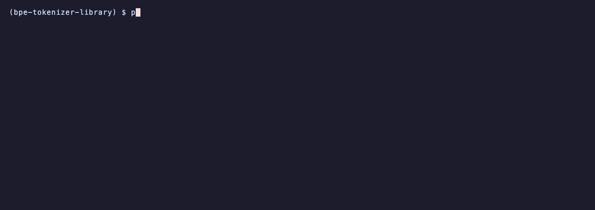
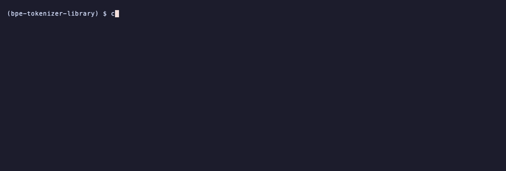
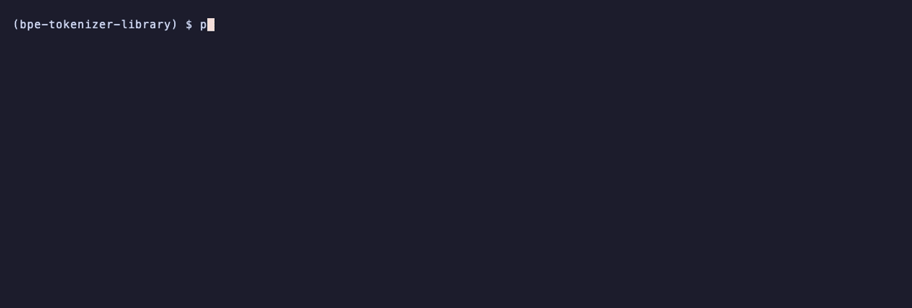

<h1 align="center">BPE Tokenizer Library</h1>

<p align="center">
  <em>A from-scratch tokenizer that splits text into pieces with GPT-2's method, using a fast Rust core that matches a readable Python version token for token.</em>
</p>

<p align="center">
  <a href="https://github.com/adeoluo/bpe-tokenizer-library/actions/workflows/ci.yml"></a>
  <a href="https://github.com/adeoluo/bpe-tokenizer-library/releases"></a>
  
  
  <a href="LICENSE"></a>
</p>

---

> **Evidence level: publicly benchmarked.** The Rust core gives the same tokens as its Python reference. The tokenizer was trained on 100 MB of C4 web text and compared with tiktoken. No one else has reproduced the results, and the library is not used in production. [What the levels mean](https://github.com/adeoluo#evidence-levels).

## Highlights

Before a language model reads text, a tokenizer splits the text into small pieces called
tokens. This project builds the same kind of tokenizer GPT-2 uses, byte-level byte-pair
encoding (BPE), from scratch.

- **It trains a GPT-2 sized vocabulary in seconds.** It learned a vocabulary of 50,257 tokens
  from 100 MB of C4 web text in 6.7 seconds, on an 8-core Apple M1.
- **It encodes batches of text faster than OpenAI's tiktoken.** On 8 threads it encoded 68.5 MB
  of held-out web text per second, compared with 52.4 MB per second for tiktoken. Higher is
  better.
- **It never loses text.** Decoding the tokens of any valid Unicode text gives back the exact
  original, including emoji and non-Latin scripts such as Japanese.
- **The fast version gives the same tokens as the simple one.** The parity tests compare the
  Rust core with the readable Python version on 12,223 strings and four merge lists. They
  found 0 mismatches.

**Where it falls short:** on a single thread it is level with tiktoken (within 3%), not
ahead. Its compression is slightly better than tiktoken's (4.61 compared with 4.54 bytes per
token). Part of that advantage comes from training on the same kind of text it was tested on.

## Key terms

Plain definitions of the terms used in this README.

| Term | Meaning |
|---|---|
| Backend | The implementation that does the work. This library has two, the Rust core (the default) and the Python reference, and both give the same output. |
| Byte-level mapping | GPT-2's fixed table that turns each of the 256 possible byte values into one printable character and back, so any text can be stored and restored without loss. |
| Byte-pair encoding (BPE) | A method that builds a vocabulary by repeatedly joining the most frequent pair of neighbouring symbols in a text collection into one new symbol. |
| Bytes per token | A compression measure: the average number of text bytes that one token covers, which is 1.00 with no merges. Higher is better, because the text then needs fewer tokens. |
| C4 | The Colossal Clean Crawled Corpus, a large public collection of cleaned English web pages. It is used here for training and testing at realistic scale. |
| Corpus | The collection of text used to train the tokenizer. The bundled corpus is 10 short English sentences, each repeated 20 times. |
| Encode and decode | Encoding turns text into a list of token ids. Decoding turns token ids back into text. |
| GIL | The Global Interpreter Lock: Python's rule that only one thread runs Python code at a time. Code that releases it can use several processor cores at once. |
| GPT-2 | A language model released by OpenAI in 2019. This library implements its tokenizer method: byte-level BPE, with a vocabulary of 50,257 tokens. |
| Heap trainer | The current Rust trainer. It keeps pair counts in a max-heap, a structure that returns the largest item quickly, instead of scanning every pair count for each merge. |
| Held-out text | Text kept out of training and used only for testing. It shows how the tokenizer handles text it has not seen. |
| Lossless | Decoding the tokens of a text gives back exactly the original text, byte for byte. This is also called an exact round trip. |
| Merge | One learned rule that joins two symbols into a new token. Its rank is its position in the learned list, and lower ranks are applied first. |
| p50 and p95 latency | Request times in milliseconds: half of requests take the p50 time or less, and 95 of 100 take the p95 time or less. Lower is better. |
| Parity | The Rust core and the Python reference give identical results for the same input. It is measured as the number of mismatches, and the goal is 0. |
| Pre-tokenization | The first step of encoding, where a regular expression (a text pattern) splits the text into word-like chunks. Merges never cross chunk borders. |
| Rust core | The fast implementation, written in Rust (a compiled programming language). Installing the package builds it in, and the library uses it by default. |
| Throughput | How much work is done per second: megabytes of text encoded per second (MB/s), or requests answered per second. Higher is better. |
| tiktoken | OpenAI's open-source tokenizer library, written for speed, and the comparison point here. Its "gpt2" encoding uses GPT-2's own published vocabulary. |
| Token | One piece of text in the vocabulary, such as a byte, part of a word or a whole word. Each token has a number, its token id. |
| Tokenizer | The program that splits text into tokens before a language model reads it, and joins tokens back into text afterwards. |
| Unicode | The standard that gives every character in every writing system a number. Python updates its Unicode version between releases, which changes how some characters are classified. |
| UTF-8 | The most common way to store Unicode text as bytes. One character takes 1 to 4 bytes. |
| Vocabulary size | The number of distinct tokens: 256 single-byte tokens plus the tokens created by merges. GPT-2 uses 50,257. |
| WebText | The collection of web pages that OpenAI used to build GPT-2's vocabulary. It is different text from C4. |

## Motivation

Every language model starts with a tokenizer. The tokenizer used by GPT-2 and its successors
is **byte-level byte-pair encoding**, and it has three parts worth understanding. First, a
reversible map from bytes to printable characters makes the tokenizer lossless for any text.
Second, a regular expression (a text-matching pattern) splits text into word-like chunks. Third, a learned list of merges
is applied in order of rank. This library implements all three and follows the GPT-2 algorithm.
The Python implementation is the readable reference, and it uses only the Python standard
library.

Because it works on bytes, it round-trips **any** valid Unicode string exactly, including emoji,
accented text and non-Latin scripts. Tokenizers that split text into characters cannot
guarantee this.

Encoding and training run on a Rust core. PyO3 (a library that connects Rust code to Python)
exposes the core to Python. Installing the package compiles the core in, so every user gets it.
It encodes 12 to 16 times faster than the Python implementation. Tests check that it produces
byte-for-byte identical output. The Python version stays as the readable reference that the
Rust core is checked against.

## Architecture

<p align="center">
  
</p>

<sub>Legend: amber marks entry points and external systems, and indigo marks core logic. Green marks data and state, blue marks validation and control, and grey marks monitoring and outputs.</sub>

Training starts from a corpus that has been pre-tokenized and converted to byte-level
characters. It counts every pair of neighbouring symbols, merges the most frequent pair, and
repeats. The result is an ordered list of merges, and this list is the model. Encoding applies
those merges by rank inside each chunk.

`BPETokenizer` is the single Python interface. By default (`backend="rust"`) it passes the work
to the `bpe_tokenizer_rs` extension, the Rust core connected through PyO3, which the install
compiles into the package. It falls back to the Python implementation only if the extension is
missing or has no table for the running Python's Unicode version. Parity tests require the two
paths to give identical output.

The HTTP service checks text length and token id ranges before it calls the same interface. It
also exposes metrics for Prometheus (a monitoring system). The evaluation reports compression,
whether round trips are lossless, and throughput. See the [ADRs](docs/adr/) (architecture
decision records) for the key decisions.

### What it implements

- **Reversible byte-level mapping**: GPT-2's fixed map from the 256 byte values to printable
  characters. Any UTF-8 text becomes printable characters and comes back with no loss.
- **GPT-2 pre-tokenization**: the standard GPT-2 regular expression. It keeps a leading space
  attached to the word after it. It separates letters, digits and punctuation, and it counts
  underscores as punctuation. Merges never cross the borders between chunks.
- **BPE training**: the trainer repeatedly merges the most frequent pair. A tie between pairs is
  always broken the same way (the pair that sorts first as text wins), so training is
  reproducible.
- **Rank-based encoding**: merges are applied lowest rank first, the same way GPT-2 does. The
  merge list can be saved to and loaded from JSON (a common text format for data).
- **Rust core** (`rust/`): the same pre-tokenizer, byte map, merge loop and trainer, written in
  Rust. The pre-tokenizer uses character-class tables (lists of which characters count as
  letters, digits or spaces). These tables are generated from Python's own `re` module, its
  regular-expression library, for each supported Unicode version. For chunks of 64 bytes or
  more, the merge loop switches to a heap, a structure that finds the lowest rank quickly.

## Results

> Reproduce with `python -m bpe_tokenizer_library train`. The tokenizer is trained on the
> built-in corpus. The metrics are measured on a separate held-out passage that is not part of
> the training text.

The table shows how compression changes as the vocabulary grows. Each row is one requested
vocabulary size. Compression is in bytes per token (higher is better), and "Lossless" says
whether every test string came back exactly.

| Vocabulary size | Compression (bytes/token) | Lossless |
|---|---:|:--:|
| 256 (no merges) | 1.00 | yes |
| 400 | 2.42 | yes |
| 600 (requested) | 3.74 | yes |

The small bundled corpus runs out of pairs to merge after 237 merges (vocabulary 493). So
asking for a larger vocabulary adds no tokens. A larger corpus keeps improving compression.
Compression rises from one token per byte to **3.74 bytes per token** as merges are learned.
Every configuration round-trips the full set of difficult test strings **exactly**. The set
includes emoji, Japanese, accented letters, control whitespace (tabs and newlines) and the
empty string.

### Encode throughput: Python, Rust, tiktoken

> uv is a Python project manager, and maturin builds Rust code into a Python module. Reproduce
> with these commands: `uv sync --group rust`, `uv run maturin develop --uv --release -m rust/Cargo.toml`,
> then `uv run python benchmarks/compare.py`. The measurements use an Apple M1, macOS and
> Python 3.12, on a single thread. Each figure is the best of five runs on about 1 MB of text.
> Absolute figures change with machine load: an earlier run on a busier machine measured about
> a quarter of these. The ratios are the stable part. The script checks that the Python column
> really runs the Python backend. The default backend is Rust, and before this check was added
> the script timed Rust in both columns.

The table compares single-thread encoding speed on two 1 MB inputs. Each row is one input, and
each column gives one tokenizer's speed in megabytes per second (higher is better). The last
column shows how many times faster the Rust backend is than the Python backend.

| Workload | Python backend | Rust backend | tiktoken (gpt2) | Rust / Python |
|---|---:|---:|---:|---:|
| English text, 1 MB | 2.03 MB/s | 32.96 MB/s | 31.03 MB/s | 16x |
| Random Unicode, 1 MB | 4.60 MB/s | 53.27 MB/s | 22.35 MB/s | 12x |

The Python and Rust columns use the same merges (vocabulary 493) and return identical token
ids. The benchmark checks this before timing. tiktoken runs its own GPT-2 vocabulary of 50,257
tokens, so its column is a speed reference only. The vocabularies differ, so the token ids and
the amount of merge work per byte also differ. The figures do not show that one tokenizer is
faster than the other on equal terms. The comparison with equal vocabulary sizes on real text
is below.

### Trained on real web text at GPT-2's vocabulary size

> Reproduce with two C4 English shards. A shard is one file of the dataset, such as
> `https://huggingface.co/datasets/allenai/c4/resolve/main/en/c4-train.0000N-of-01024.json.gz`.
> Then run `uv run --no-sync --with tiktoken python benchmarks/c4_scale.py --c4 <shard 0> --heldout <shard 1>`.
> The measurements use an Apple M1 with 8 cores. Raw numbers: [benchmarks/results/c4_scale.json](benchmarks/results/c4_scale.json).

The trainer finds the next merge with a max-heap, a structure that always returns the largest
item first. The heap uses exactly the same order as the Python trainer: highest count first,
then the pair that sorts first as text. The previous trainer instead scanned every pair count
for each merge. The new trainer learns the same merges as before, and the parity suite checks
this against the Python trainer.

The next table compares the previous trainer with the heap trainer on growing amounts of C4
text. Each row is one amount of text. Times are in seconds, and lower is better. "Speedup" is how
many times faster the heap trainer is. "Same merges" says whether both trainers learned
identical merge lists.

| C4 text | Vocabulary | Previous trainer | Heap trainer | Speedup | Same merges |
|---:|---:|---:|---:|---:|:---:|
| 1 MB | 8,192 | 0.6 s | 0.2 s | 2.8x | yes |
| 4 MB | 8,192 | 1.3 s | 0.5 s | 2.5x | yes |
| 16 MB | 8,192 | 2.8 s | 1.4 s | 2.0x | yes |
| 100 MB | 50,257 | 47.8 s | 6.7 s | **7.1x** | verified on <= 16 MB |

A vocabulary of 50,257 tokens, the size of GPT-2's, was trained on 100 MB of C4 in 6.7 seconds.
An earlier single timing of the previous trainer took 47.8 seconds. Exact equality of the merges
is checked directly on the 1 MB to 16 MB slices and in `tests/test_rust_parity.py`.

The last table compares this tokenizer with tiktoken's GPT-2 encoding on 20 MB of held-out C4
text: 9,509 documents from a different shard. Both vocabularies have the same size. Each row is
one tokenizer. Bytes per token measures compression, and the two encode columns give speed in
megabytes per second. Higher is better in every column.

| Tokenizer | Bytes per token (higher is better) | Encode, 1 thread | Encode, batch (8 threads) |
|---|---:|---:|---:|
| **bpe-tokenizer-library, trained on C4** | **4.61** | **19.4 MB/s** | **68.5 MB/s** |
| tiktoken gpt2 | 4.54 | 18.8 MB/s | 52.4 MB/s |

How to read this: compression is 1.5% better. But this tokenizer was trained on C4 itself, while
GPT-2's vocabulary was trained on WebText. So part of that advantage comes from training on the
same kind of text (in-domain training), not from a better algorithm. Single-thread encoding is
level with tiktoken (within 3%). Batch encoding is 1.3 times faster because `encode_batch` now
spreads texts across all cores and releases Python's Global Interpreter Lock (GIL). In the recorded run, the round-trip check
covered the first 2,000 of the 9,509 held-out documents, and all of them came back exactly. The
script now checks all 9,509 documents, but the recorded results come from the earlier version.
The parity tests in `test_rust_parity.py` also round-trip 12,223 strings, including 8,000 seeded
random Unicode strings.

### Parity guarantee

The Rust backend must match the Python implementation byte for byte. It must give the same
pre-tokenization chunks, the same token ids and the same decoded text, including how invalid
UTF-8 is replaced. It must also raise the same errors for unknown ids and learn the same merges.
The parity suite (`tests/test_rust_parity.py`) checks this on the inputs below.

Each row of the table is one kind of check. "Inputs" says what was compared, and "Mismatches"
counts the differences between the two backends (0 is the goal).

| Check | Inputs | Mismatches |
|---|---:|---:|
| Pre-tokenization | 12,223 strings, plus every Unicode scalar value in four arrangements | 0 |
| Encode ids and round-trip decode | 12,223 strings x 4 merge sets (0 to 944 merges) | 0 |
| Decode of random id sequences | 3,000 sequences, mostly invalid UTF-8 | 0 |
| Training | 3 corpora x 3 vocabulary sizes | 0 |

The strings come from five sources. They are the bundled corpus and the round-trip test set.
They also include 8,000 seeded random Unicode strings, generated from a fixed starting value so
every run gets the same strings. Half of these cover the full range of Unicode characters. Next
come 4,000 seeded strings built from small, difficult pieces: whitespace, contractions such as
"'s", underscores, digits, emoji and text in several scripts. Last come 200 long chunks that use
the heap merge path. Python's `re` decides each character's class with the Unicode database of
the Python version that runs it. So the extension ships one generated table per version: Unicode
15.0, 15.1, 16.0 and 17.0, for Python 3.12 through 3.15. The suite passed under each version. On
any other Python version, the tokenizer stays on the Python backend rather than risk a
difference.

### Lossless on inputs that break naive tokenizers

The table lists sample inputs that often break simpler tokenizers. Each row is one input, and
"yes" means that decoding its tokens gave back exactly the same text.

| Input | Round-trips exactly |
|---|:--:|
| `café naïve résumé` | yes |
| `emoji: 😀🚀🧠 end` | yes |
| `日本語のテキスト` | yes |
| `tabs\tand\nnewlines` | yes |
| `snake_case __dunder__` | yes |
| `a_b _ _x_ trailing_` | yes |

A property test (a test that checks one rule on many generated inputs) enforces losslessness.
It pre-tokenizes **3,000 random Unicode strings** and checks that joining the chunks rebuilds
each input exactly. The strings are seeded and cover Latin letters, punctuation, accented
letters and CJK (Chinese, Japanese and Korean) characters. An earlier version of the
pre-tokenizer silently dropped underscores, and any other word character that is neither a
letter nor a digit. That broke the round trip. The fixed regular expression and the property
test were added together, so the test catches this kind of defect if it comes back. See [the pre-tokenizer notes](src/bpe_tokenizer_library/pretokenize.py).

### Scale (Python backend)

> Reproduce with `uv run python benchmarks/scale.py`. The script trains once, then encodes
> held-out passages of increasing size. Peak memory comes from `tracemalloc`, Python's built-in
> memory tracer.

The table shows how the Python backend behaves as the input grows. Each row is one input size.
Lower time and memory are better, higher throughput is better, and "Lossless" says whether the
text came back exactly. MiB is a mebibyte, 1,048,576 bytes.

| Input size | Encode time | Throughput | Tokens | Peak memory | Lossless |
|---|---:|---:|---:|---:|:--:|
| 23,200 bytes | 0.06 s | ~414,000 bytes/s | 6,200 | 0.3 MiB | yes |
| 116,000 bytes | 0.28 s | ~419,000 bytes/s | 31,000 | 1.5 MiB | yes |
| 464,000 bytes | 1.10 s | ~423,000 bytes/s | 124,000 | 5.8 MiB | yes |
| 1,160,000 bytes | 2.74 s | ~423,000 bytes/s | 310,000 | 14.5 MiB | yes |

Encoding speed per byte stays about constant, and memory grows in proportion to the input size.
The round trip stays lossless at more than a megabyte of input. This table measures how the
Python implementation scales with `tracemalloc` switched on, which slows it about fivefold. For
real wall-clock speed, see the throughput comparison above.

### Evaluation

The corpus is bundled and training is deterministic: it gives the same result every time. So the
results on the bundled corpus can be reproduced without a network connection. Full method and
tables: [`docs/EVALUATION_REPORT.md`](docs/EVALUATION_REPORT.md).

### Comparison scope

Compression on the bundled corpus is measured against a raw-byte baseline (one token per byte),
not against the vocabulary of an established tokenizer. Speed is compared with
[tiktoken](https://github.com/openai/tiktoken) as a reference point only, because the
vocabularies differ. [Hugging Face Tokenizers](https://github.com/huggingface/tokenizers), a
widely used tokenizer library, has not been measured. The results show a faithful, lossless
implementation of the GPT-2 byte-level BPE algorithm. They also show a Rust core that reproduces
it exactly, at about the same speed as a compiled tokenizer.

## Quickstart

```bash
git clone https://github.com/adeoluo/bpe-tokenizer-library.git && cd bpe-tokenizer-library
make setup                      # install dev tooling + pre-commit hooks
make all                        # lint + type-check + test

python -m bpe_tokenizer_library train              # train and report metrics
python -m bpe_tokenizer_library encode "the dog"    # encode a string and show the round-trip
```

```python
from bpe_tokenizer_library import BPETokenizer, sample_corpus

tok = BPETokenizer.train(sample_corpus(), vocab_size=600)
ids = tok.encode("café 😀")
assert tok.decode(ids) == "café 😀"
```

## Usage

### Command line

```bash
python -m bpe_tokenizer_library train              # train and report metrics
python -m bpe_tokenizer_library encode "the dog"    # encode a string and show the round-trip
python -m bpe_tokenizer_library serve               # start the HTTP service on :8000
```

### Library API

`BPETokenizer.train(corpus, vocab_size)` learns merges. `encode`, `decode`, `encode_batch` and
`tokens` apply them. `to_json` and `BPETokenizer.from_json` save and load the merge list.

### Backends

maturin, the package's build backend, builds the Rust core from `rust/`. So `pip install` and
`uv sync` compile the core into the package. This needs a Rust toolchain (the Rust compiler and
its tools). After a change to `rust/`, `make rust-develop` rebuilds it in place.

```python
from bpe_tokenizer_library import BPETokenizer, rust_available, sample_corpus

tok = BPETokenizer.train(sample_corpus(), vocab_size=600)  # Rust core by default
print(rust_available(), tok.backend)  # True rust
ids = tok.encode("café 😀")  # identical ids to the Python backend
reference = tok.with_backend("python")  # the readable Python implementation
```

`backend="rust"`, the default, is a preference, not a requirement. If the extension is missing,
or has no character table for the running Python's Unicode version, the tokenizer uses the
Python backend. In that case `tok.backend` reports `"python"`. On the Rust backend, `encode_batch`
releases the GIL while it encodes.

### HTTP service

A small HTTP service, built only with the Python standard library, trains once at startup. It
then encodes and decodes text. The routing logic is a pure function (its output depends only on
its inputs), so it is tested without a network socket. A concurrent stress benchmark
(`uv run python benchmarks/stress.py`) sends 10000 requests from 8 workers directly to the
`/encode` handler, without a network connection. On the default Rust backend, the handler
answers about **69,000 requests per second**. The median request (p50) takes **0.006 ms**, and
95% of requests take **0.45 ms** or less (p95).

The service answers these requests:

| Method | Path | Purpose |
|---|---|---|
| GET | `/health` | liveness and vocabulary size |
| GET | `/ready` | readiness once the tokenizer is trained |
| GET | `/metrics` | per-route request, error, and latency metrics (Prometheus text) |
| POST | `/encode` | body `{"text": str}`; returns token ids and glyph tokens |
| POST | `/decode` | body `{"ids": [int]}`; returns the decoded text |
| POST | `/stats` | body `{"text": str}`; returns byte length, token count, bytes per token |

### Demonstration

```text
$ python -m bpe_tokenizer_library train
Trained a byte-level BPE tokenizer: vocab 493, 237 merges.
  held-out compression: 3.74 bytes/token (31 tokens)
  lossless on the round-trip battery: True
  encode throughput: 564,232 bytes/sec
```

### Demos

These recordings come from real runs with [vhs](https://github.com/charmbracelet/vhs), a tool that records terminal sessions. Each tape (vhs script) is in `docs/demo/`.

Training the byte-level BPE, then encoding text with it.

<p align="center">
  
</p>

The HTTP service: encode, decode, and compression statistics.

<p align="center">
  
</p>

Byte-level encoding of accented text, CJK, and emoji, with a lossless round trip.

<p align="center">
  
</p>

## Design decisions

- **Byte-level, not character-level**: the tokenizer works on bytes through a reversible
  mapping, so it is lossless for any valid Unicode text. See [ADR 0002](docs/adr/0002-byte-level.md).
- **Merge ranks for encoding**: merges are applied lowest rank first, following GPT-2's merge
  procedure, which keeps encoding deterministic. See [ADR 0003](docs/adr/0003-merge-ranks.md).
- **Rust core by default, with a Python reference and fallback**: every install compiles the Rust
  core, and the library uses it unless `backend="python"` is requested. The Python
  implementation stays the reference that the Rust core must match exactly. See
  [ADR 0004](docs/adr/0004-rust-core.md).

## Testing

```bash
make all                                   # ruff, mypy --strict, pytest with an 80% coverage gate
cd rust && cargo fmt --check && cargo clippy -- -D warnings && cargo test
BPE_REQUIRE_RUST=1 uv run pytest tests/test_rust_parity.py   # after maturin develop
```

- **Python tests** cover the byte map, pre-tokenizer, trainer, tokenizer, evaluation helpers,
  command-line interface, HTTP service and backend fallback. They pass without the Rust
  extension, and the parity module skips itself when the extension is not built.
- **Property tests** round-trip thousands of seeded random Unicode strings.
- **Rust unit tests** (`cargo test`, Rust's test runner) cover the byte map, pre-tokenizer
  branches, per-version Unicode tables, merge ranks, decode errors, the trainer, and agreement
  between the scan and heap merge loops.
- **Parity tests** compare the two backends as described under Results. Continuous integration
  (CI, the automatic checks that run on every change) runs them in a separate `rust` job. The
  job runs the Rust format check, clippy (a Rust code checker), cargo test, a package build with
  the Rust core, and the parity tests. It sets `BPE_REQUIRE_RUST=1`, so a missing extension
  fails the job instead of skipping the tests.

## Responsible AI

- **Model card:** [`docs/MODEL_CARD.md`](docs/MODEL_CARD.md)
- **Data card:** [`docs/DATA_CARD.md`](docs/DATA_CARD.md)
- **Threat model:** [`docs/THREAT_MODEL.md`](docs/THREAT_MODEL.md)

## Limitations

- The bundled corpus is small, so learned merges stop at a few hundred and compression levels
  off. Training on a larger corpus keeps improving it.
- Installing from source compiles the Rust core, so it needs a Rust toolchain. Prebuilt wheels
  (ready-to-install packages) are attached to releases for macOS arm64 only.
- The Python backend is kept as the reference and fallback. It encodes about 2 to 5 megabytes
  per second on an idle Apple M1. On a busy one it encodes well under 1 megabyte per second.
- Rust parity depends on a generated character table for each Unicode version. A new Python
  release with a newer Unicode database uses the Python backend until a table is generated for
  it (`scripts/gen_unicode_tables.py`).
- The implementation follows the GPT-2 algorithm, but it does not ship GPT-2's published
  vocabulary file. So it reproduces the method, not that specific vocabulary.

## Roadmap

- [x] Rust core with PyO3 bindings and byte-for-byte parity tests.
- [x] Encode throughput compared with tiktoken.
- [ ] Load GPT-2's published merges to compare token ids directly with tiktoken.
- [ ] Benchmark against Hugging Face Tokenizers.
- [ ] Publish wheels for Linux and Windows.
- [ ] Add special-token handling and an added-tokens table.

## License

Released under the [MIT License](LICENSE).
